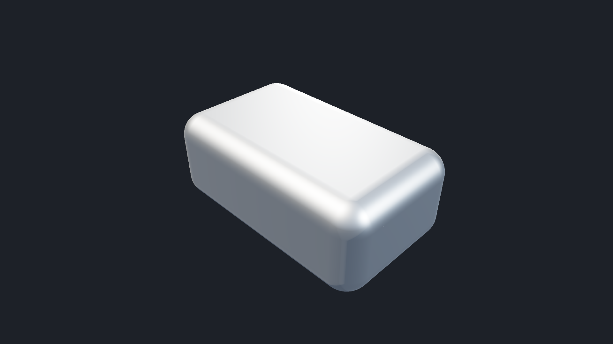
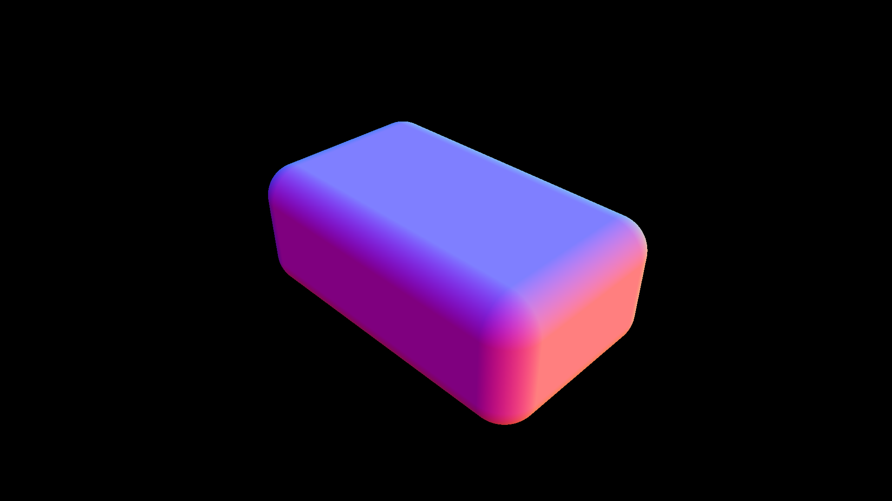

# NURBS OptiX renderer

**Direct NURBS rendering in OptiX without tessellation, with a metallic PBR material.**

A Windows C++20 / CUDA application that imports STEP BRep topology with Open CASCADE and intersects the original rational spline surfaces on the GPU. Geometry remains a collection of weighted control points and UV boundary curves. The renderer generates no triangles and uses no tessellation fallback.

**1920 x 1080 GPU performance on RTX 5060:** scene already loaded; loading, parsing, setup, transfers, validation, and PNG encoding excluded. Median of 30 frames after warmup:

| Mode | GPU frame time | GPU frames/s |
| --- | ---: | ---: |
| Four-sample antialiasing (image below) | **59.5 ms** | **16.8** |
| One-sample preview | **15.3 ms** | **65.4** |

The four-sample mode is approximately **36 times faster** than the original GPU implementation. Both modes render NURBS directly without tessellation and use the simplified metallic PBR material.



The final image is **1920 x 1080**, viewed from **35 degrees above horizontal**. The supplied [rounded-box STEP sample](INPUT/rounded_box_nurbs/rounded_box_nurbs.step) measures 20 x 12 x 8 model units and contains **26 BRep faces**, including **20 rational B-spline faces**. Its source was `D:\rounded_box_nurbs.step`; the copy in this repository is unchanged.

## Metallic PBR material

The sample uses a silver conductor with the following parameters:

| Property | Value |
| --- | --- |
| Metallic | 1.0 |
| Roughness | 0.24 |
| Linear reflectance at normal incidence | (0.91, 0.92, 0.92) |
| Microfacet distribution | GGX |
| Masking and shadowing | Separable Smith |
| Fresnel | Schlick approximation |
| Lighting | Three GGX studio lights and a room environment lookup |
| Evaluation | Three direct-light evaluations; no environment sampling loop |
| Antialiasing | Four primary rays per pixel by default; optional one-ray preview |
| Output | Filmic tone mapping, sRGB encoding, Windows WIC PNG |

Surface normals come directly from the rational surface's partial derivatives and BRep face orientation. The simplified material keeps GGX, Smith masking/shadowing, and Schlick Fresnel; source size is approximated by broadening each light's specular lobe. It replaces the original 256-sample environment integration with three direct-light evaluations and one room reflection lookup. Material and environment settings are defined in [cuda/NurbsDevice.cuh](cuda/NurbsDevice.cuh). Secondary scene reflections and shadow rays are not implemented.

## Build and render

The verified development environment uses Windows x64, Visual Studio Community 2026 / MSVC 19.51, CMake 4.4.4, CUDA 13.2, OptiX 9.1, OCCT 7.9.3, and an RTX 5060. The project requires CMake 4.2 or newer, CUDA 13.2 or newer, and the OptiX 9.1 SDK.

On this machine, `CMakeUserPresets.json` supplies installed SDK and runtime paths. `Run.local.ps1` uses those paths to launch the executable. Both files are machine-local and ignored by Git.

```powershell
cd C:\Projects\DL2_RT
cmake --preset local-release
cmake --build --preset local-release --parallel 8
powershell.exe -NoProfile -ExecutionPolicy Bypass -File .\Run.local.ps1 `
    -OutputPath .\output\rounded-box-nurbs-metallic.png -ValidateNurbs
```

The launcher defaults to the rounded-box sample, 1920 x 1080, and 35-degree camera elevation. It also accepts `-InputPath`, `-Width`, `-Height`, `-CameraElevation`, `-SamplesPerPixel`, `-BenchmarkFrames`, and `-Profile`. For Debug:

```powershell
cmake --preset local-debug
cmake --build --preset local-debug --parallel 8
powershell.exe -NoProfile -ExecutionPolicy Bypass -File .\Run.local.ps1 `
    -Configuration Debug -Width 480 -Height 360 `
    -OutputPath .\output\rounded-box-nurbs-debug.png -ValidateNurbs
```

The execution-policy option applies only to that PowerShell process.

### Setup on another Windows machine

Install Visual Studio 2026 with Desktop development with C++, MSVC v145 and a Windows SDK; CMake; CUDA; and OptiX. Install OCCT with matching x64 Release and Debug libraries. The official [OCCT 7.9.3 release](https://github.com/Open-Cascade-SAS/OCCT/releases/tag/V7_9_3) supplies `opencascade-7.9.3-vc14-64-with-debug-combined.zip`, which includes the third-party dependencies used below.

Adjust these paths to your installation, then use the shared presets:

```powershell
cd C:\Projects\DL2_RT
$env:OPTIX_ROOT = 'C:\ProgramData\NVIDIA Corporation\OptiX SDK 9.1.0'
$env:OCCT_ROOT = 'C:\SDKs\OCCT-7.9.3\opencascade-7.9.3-vc14-64'
$thirdParty = 'C:\SDKs\OCCT-7.9.3\3rdparty-vc14-64'
$configuration = 'Release'
$preset = 'vs2026-' + $configuration.ToLowerInvariant()
$occtDllDirectory = if ($configuration -eq 'Debug') { 'bind' } else { 'bin' }
$env:PATH = "$env:OCCT_ROOT\win64\vc14\$occtDllDirectory;" +
    "$thirdParty\tbb-2021.13.0-x64\bin;" +
    "$thirdParty\jemalloc-vc14-64\bin;" +
    "$thirdParty\freetype-2.13.3-x64\bin;" +
    "$thirdParty\freeimage-3.18.0-x64\bin;" +
    "$thirdParty\ffmpeg-3.3.4-64\bin;" +
    "$thirdParty\openvr-1.14.15-64\bin\win64;" + $env:PATH

cmake --preset $preset
cmake --build --preset $preset --parallel 8
& ".\out\build\$preset\bin\$configuration\NurbsOptixRenderer.exe" `
    --input .\INPUT\rounded_box_nurbs\rounded_box_nurbs.step `
    --output .\output\rounded-box-nurbs-metallic.png --validate-nurbs
```

OCCT's STEP library loads application and visualization dependencies even for offscreen import, so the FreeType, FreeImage, FFmpeg, and OpenVR runtime paths are needed by this OCCT distribution. Match OCCT Debug DLLs with Debug builds and Release DLLs with Release builds. Rendering uses OptiX.

CMake compiles `cuda/DevicePrograms.cu` into PTX beside each executable and stages the original NURBS sample there. No separate `nvcc` invocation is needed. `cmake --open out/build/vs2026-debug` opens the generated Visual Studio solution; its startup project is `NurbsOptixRenderer`.

## Command-line interface

```text
NurbsOptixRenderer
    [--input file-or-directory]
    [--output output.png]
    [--width 1920] [--height 1080]
    [--camera-elevation 35]
    [--validate-nurbs]
    [--samples 1|4]
    [--benchmark frames] [--profile]
```

With no arguments, the executable reads `rounded_box_nurbs.step` beside itself and writes `output.png` in the working directory. `--input` accepts a STEP file or a directory containing exactly one `.step` or `.stp` file. Dimensions must be 1..16384. Camera elevation must be a finite angle in -89..89 degrees; positive elevation looks down on the model while preserving the viewing azimuth. The scene uses Z as up.

Successful rendering returns 0. Input, import, API, or reference-validation errors return 1. Exhausting the intersection solver's subdivision or root budget returns 2 and prevents writing a successful render.

## GPU frame performance

Measured on the RTX 5060 in Release at 1920 x 1080 on **6 November 2026**. The benchmark loads the model and builds the OptiX scene once, warms up one frame, then times 30 GPU launches with CUDA events. It reports median, minimum, and maximum frame times. **File loading, STEP parsing, geometry preparation, pipeline/GAS creation, transfers, OCCT reference validation, and PNG encoding are excluded.** This is GPU render throughput, not the end-to-end process time or a measured GUI frame rate.

| Configuration | Median GPU frame time | Equivalent GPU frames/s |
| --- | ---: | ---: |
| Original solver, four rays/pixel, 256-sample material | ~2,121 ms | ~0.47 |
| Optimized solver, four rays/pixel, simplified PBR | **59.5 ms** | **16.8** |
| Optimized solver, one ray/pixel, simplified PBR | **15.3 ms** | **65.4** |

The four-ray mode is about **36 times faster** than the original measured GPU path. The one-ray preview uses the same NURBS intersection and material but omits multisample antialiasing, so silhouettes can show pixel stair steps. The final 30-frame ranges were 57.7..63.4 ms for four rays and 14.8..17.2 ms for one ray.

```powershell
# Default four-ray quality, cached scene, 30 measured GPU frames:
powershell.exe -NoProfile -ExecutionPolicy Bypass -File .\Run.local.ps1 `
    -BenchmarkFrames 30 -ValidateNurbs -OutputPath .\output\benchmark-4spp.png

# One-ray preview, with the same geometry and simplified metallic PBR:
powershell.exe -NoProfile -ExecutionPolicy Bypass -File .\Run.local.ps1 `
    -SamplesPerPixel 1 -BenchmarkFrames 30 `
    -OutputPath .\output\benchmark-1spp.png
```

The executable equivalents are `--benchmark 30 --samples 4` and `--benchmark 30 --samples 1`. `--benchmark` accepts 1..1000 frames. More than one frame enables the warmup. `--profile` adds a separately timed geometry-only launch with normal coloring; the final output still uses the metallic material. The profile showed that surface intersection dominated the original frame time.

## Rendering workflow

1. **Import and validate the STEP BRep.** OCCT transfers the faces, placements, orientation, and UV boundary curves. The importer checks BRep validity. No mesher runs; imported face triangulations are rejected.
2. **Preserve the rational geometry.** Knot insertion converts B-spline spans into rational Bezier patches. Exact 8 x 8 subdivision of each span tightens acceleration bounds while retaining the curved surfaces and rational weights. The sample produces **1,664 rational subpatches** and **104 rational UV trim arcs**.
3. **Build a custom-primitive GAS.** Each patch contributes a conservative AABB around its positive-weight control hull. OptiX traverses one acceleration structure containing these patches. There are no triangle vertex/index buffers.
4. **Intersect the surfaces directly.** `__intersection__nurbs` projects each homogeneous control net into ray-aligned coordinates. Bezier hull and [Krawczyk interval-Newton tests](https://doi.org/10.1016/0022-247X(86)90303-3) exclude empty regions and identify isolated roots, allowing early double-precision Newton refinement. Coarse bounds use FP32 with numerical padding; ambiguous regions use FP64 bounds and subdivision. Final root residuals and surface derivatives are evaluated in FP64. Common spline degrees have specialized kernels; exactly affine degree-one patches use their linear ray solve. Multiple roots remain supported, and OptiX selects the nearest accepted surface.
5. **Respect the BRep trims.** The hit's UV coordinates are classified against the rational boundary curves using an even/odd crossing rule. Positive-weight control hulls classify crossings that lie completely to one side; linear trims use a direct solve. Other monotone rational trim arcs retain bisection. Hits outside the face boundaries are rejected.
6. **Shade the selected surface.** Surface derivatives provide its normal. The closest-hit program returns the nearest hit to ray generation, which applies metallic PBR lighting, antialiasing, tone mapping, and PNG export.

## Validation

`--validate-nurbs` compares a grid of approximately 960 primary sample rays against OCCT's independent `IntCurvesFace_ShapeIntersector`, including the original face trims. It checks hit/miss classification, depth, and outward normal agreement. Depth tolerance is scene radius x 2e-5; the normal dot product must be at least 0.999. The check requires at least 50 matching surface hits.

It also writes a `-normals.png` diagnostic beside the output. The first antialiasing subpixel supplies the validation and diagnostic data.



Verified after optimization on **6 November 2026**: both one-ray and four-ray Release modes passed the 960-ray OCCT comparison at 1920 x 1080, with 156 matching surface hits and no classification, depth-tolerance, or normal errors. Maximum depth differences were 1.97e-5 and 8.33e-6 model units respectively. Debug at 480 x 360 also passed its 960-ray comparison, with 209 matching surface hits. All runs had zero solver-budget failures.

The full-resolution four-ray normal diagnostic remains byte-identical to the original solver's diagnostic. Additional 960 x 540 renders at camera elevations 5, 75, and -35 degrees passed OCCT validation; their complete PBR images and normal diagnostics were byte-identical between the optimized mixed-precision bounds and a full-FP64 bounds reference.

The original input's SHA-256 is `09cc0f578733a4d55614f69669ce9cd81490f15f1d64300c98d95b354efc5562`.

## Supported geometry and numerical limits

Every BRep face must use a nonperiodic B-spline surface, with degree at most 3 in each parameter direction and positive finite weights. UV boundary curves support degree at most 8. Other surface types, higher degrees, periodic seam unwrapping, and trim arcs that cannot be split into monotone segments are rejected explicitly.

Intersection search uses 24 binary subdivision levels, at most 8,192 visited rectangles and eight roots per subpatch. These finite numerical limits do not guarantee completeness for arbitrary folded or nearly tangent NURBS. Validation applies to the supplied rounded-box sample.

## Source layout

| Files | Responsibility |
| --- | --- |
| `src/NurbsModel.cpp`, `NurbsModel.h` | STEP BRep import, rational patches and trims, independent OCCT validation |
| `src/Geometry.h` | Vector and bounding-box utilities |
| `src/OptixRenderer.cpp`, `OptixRenderer.h`, `ErrorChecks.h` | CUDA/OptiX resources, custom GAS, pipeline, SBT, camera, diagnostics, timings |
| `cuda/NurbsDevice.cuh`, `NurbsShared.h` | Rational evaluation, intersection, UV trimming, derivative normals, metallic PBR lighting |
| `cuda/DevicePrograms.cu`, `DeviceShared.h` | Ray generation, custom intersection and closest-hit entry points, shared launch data |
| `src/main.cpp`, `PngWriter.cpp`, `PngWriter.h` | CLI, diagnostics, WIC PNG export |
| `CMakeLists.txt`, `CMakePresets.json` | Build configuration, PTX compilation, sample staging |

Generated builds live in `out/`; runtime images live in `output/`. Both are ignored by Git. The final README screenshots are kept in `docs/images/`.
