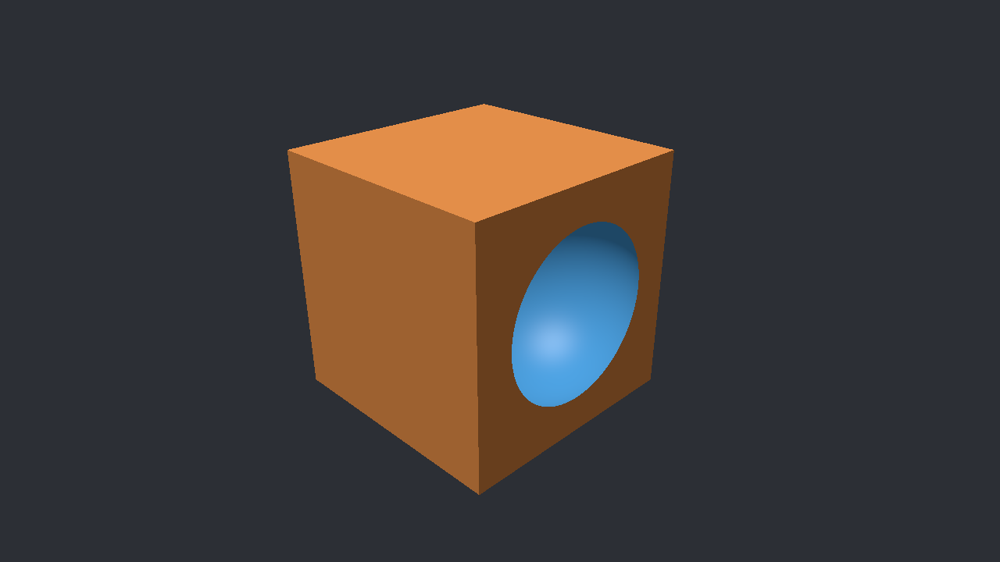

# CSG OptiX renderer

Windows C++20 / CUDA / OptiX prototype that renders a STEP Boolean expression using independently tessellated operands. The supplied `INPUT/box_sphere_intersection.STEP` describes **BOX DIFFERENCE SPHERE**: a 100 x 100 x 100 block minus a radius-40 sphere centred at (80, 50, 50). The input file is preserved unchanged, despite its misleading filename.

OCCT constructs the original primitives; OptiX traces their triangles and evaluates the Boolean tree on the GPU. The renderer creates no final Boolean B-Rep or combined Boolean mesh. Box surfaces are orange, the spherical cavity is blue, and Windows WIC writes the PNG.

## Rendered result

Actual 1280 x 720 outputs from the RTX 5060. Documentation images are saved in `docs/images`, separately from generated runtime outputs.

| Original render | Corrected Release render |
| --- | --- |
|  |  |
| Coarse sphere geometry and one lighting normal per triangle. | Explicit sphere interior meshing controls, removed zero-area pole triangles, and interpolated lighting normals. |

The corrected geometry and lighting solve different problems: tessellation improves the actual cut boundary; normal interpolation makes lighting continuous across triangles. Pixel-sized stair steps remain because the renderer uses one ray per pixel and has no antialiasing.

<details>
<summary>Corrected Debug screenshot</summary>



Debug and Release produced identical decoded pixels in the verified runs.

</details>

## Build and run on this machine

Verified on **13 October 2026** in `C:\Projects\DL2_RT`.

| Dependency | Installed version / location |
| --- | --- |
| Visual Studio Community 2026 | MSVC 19.51, Windows SDK 10.0.26100.0 |
| CMake | 4.4.4; project requires 4.2+ |
| CUDA Toolkit | 13.2.51; project requires 13.2+ |
| OptiX SDK | 9.1.0 in `C:\ProgramData\NVIDIA Corporation\OptiX SDK 9.1.0` |
| OCCT | 7.9.3 in `C:\SDKs\OCCT-7.9.3\opencascade-7.9.3-vc14-64` |
| OCCT dependencies | TBB and jemalloc in `C:\SDKs\OCCT-7.9.3\3rdparty-vc14-64` |
| GPU / driver | RTX 5060, compute 12.0, NVIDIA driver 616.92 |

`CMakeUserPresets.json` supplies the installed SDK paths and the DLL paths for each configuration. `Run.local.ps1` launches the program with those DLL paths. Both files are machine-local and ignored by Git; the next section also gives a workflow that uses only the shared presets.

Build and render Release:

```powershell
cd C:\Projects\DL2_RT
cmake --preset local-release
cmake --build --preset local-release --parallel 8
powershell.exe -NoProfile -ExecutionPolicy Bypass -File .\Run.local.ps1
```

Build and render Debug:

```powershell
cmake --preset local-debug
cmake --build --preset local-debug --parallel 8
powershell.exe -NoProfile -ExecutionPolicy Bypass -File .\Run.local.ps1 -Configuration Debug
```

The launcher uses `INPUT` and writes `output/render-release.png` or `output/render-debug.png`. It accepts `-InputPath`, `-OutputPath`, `-Width`, and `-Height`; for example:

```powershell
powershell.exe -NoProfile -ExecutionPolicy Bypass -File .\Run.local.ps1 `
    -Configuration Release -Width 1920 -Height 1080 -OutputPath .\output\render-1080p.png
```

The execution-policy argument applies to that PowerShell process only. The saved Windows policy is unchanged.

To open the configured Debug solution in Visual Studio:

```powershell
cmake --open out/build/vs2026-debug
```

Select **Debug | x64** and run `CsgOptixRenderer`. The generated `.slnx` solution uses the executable directory as its debugger working directory and supplies configuration-specific OCCT DLL paths.

## Setup on another Windows machine

Install Visual Studio 2026 with Desktop development with C++, MSVC v145 and a Windows SDK; CMake 4.2+; CUDA Toolkit 13.2+; and OptiX SDK 9.1. Use an NVIDIA GPU and a driver compatible with both CUDA and OptiX. The verified configuration above uses OCCT 7.9.3 with matching x64 Debug and Release libraries.

Download `opencascade-7.9.3-vc14-64-with-debug-combined.zip` from the [official OCCT 7.9.3 release](https://github.com/Open-Cascade-SAS/OCCT/releases/tag/V7_9_3). Extract the archive into `C:\SDKs\OCCT-7.9.3` to obtain both the OCCT directory and `3rdparty-vc14-64`.

The archive retained on this machine is `C:\SDKs\downloads\opencascade-7.9.3-vc14-64-with-debug-combined.zip`. Its SHA-256 was verified against the release asset's published digest:

```text
cb008fd982c1d7725d425e10af2cc373c870a8b99d3d7b6420a9f92f89a065fe
```

Use the shared presets with your SDK paths. Change `$configuration` to `Debug` to select Debug OCCT DLLs and the Debug preset:

```powershell
cd C:\Projects\DL2_RT
$env:OPTIX_ROOT = 'C:\ProgramData\NVIDIA Corporation\OptiX SDK 9.1.0'
$env:OCCT_ROOT = 'C:\SDKs\OCCT-7.9.3\opencascade-7.9.3-vc14-64'
$thirdParty = 'C:\SDKs\OCCT-7.9.3\3rdparty-vc14-64'
$configuration = 'Release'
$preset = 'vs2026-' + $configuration.ToLowerInvariant()
$occtDllDirectory = if ($configuration -eq 'Debug') { 'bind' } else { 'bin' }
$env:PATH = "$env:OCCT_ROOT\win64\vc14\$occtDllDirectory;" +
    "$thirdParty\tbb-2021.13.0-x64\bin;" +
    "$thirdParty\jemalloc-vc14-64\bin;" + $env:PATH

cmake --preset $preset
cmake --build --preset $preset --parallel 8
& ".\out\build\$preset\bin\$configuration\CsgOptixRenderer.exe" `
    --input .\INPUT --output .\output\render.png
```

Match Debug OCCT libraries and DLLs with Debug builds, and Release with Release. The official 7.9.3 package used here requires both TBB and jemalloc on `PATH`.

If package discovery needs an explicit path, add `-DOpenCASCADE_DIR="C:/path/containing/OpenCASCADEConfig.cmake"` to the configure command. To select CUDA explicitly, add `-DCUDAToolkit_ROOT="C:/Program Files/NVIDIA GPU Computing Toolkit/CUDA/v13.2"`.

## Rendering workflow

1. **Parse the STEP expression.** Read the represented CSG solid and preserve its Boolean tree, original primitives, and placements. The supplied model resolves to three nodes: BOX, SPHERE, and DIFFERENCE.
2. **Construct and tessellate each operand.** OCCT builds the box and sphere separately in local coordinates. The mesher applies face locations and winding corrections, discards zero-area triangles, and generates radial vertex normals for the sphere.
3. **Build acceleration structures.** Upload the meshes and build one OptiX geometry acceleration structure (GAS) per operand. An instance acceleration structure (IAS) applies the STEP placements. Coordinates are centred for GPU precision.
4. **Collect and classify ray intersections.** Any-hit programs collect up to 32 triangle intersections per ray. The GPU sorts and groups coincident crossings, then evaluates the Boolean tree to find the first boundary of the result.
5. **Shade the selected boundary.** Geometric triangle normals determine entering and leaving events. Interpolated sphere normals affect lighting only. Difference boundaries reverse the normals to point out of the resulting solid, into the cavity.
6. **Write the PNG.** WIC converts the renderer's RGBA pixels to the encoder's negotiated format and writes the selected output path.

CMake compiles `cuda/DevicePrograms.cu` into `DevicePrograms.ptx` beside each configuration's executable and stages a copy of the original STEP file there. PTX uses virtual architecture `compute_75`; OptiX JIT compiles it for the GPU. No separate manual `nvcc` command is needed.

The executable supports only `--input`, `--output`, `--width`, `--height`, and `--help`. Dimensions must be 1..16384. `--input` accepts an exact STEP path or a directory containing exactly one `.step`/`.stp` file. With no arguments, it reads the staged STEP file beside the executable and writes `output.png` in the working directory at 1280 x 720.

Console output includes the parsed tree, mesh sizes, acceleration-structure and pipeline timings, GPU render time, and hit-overflow count. Successful rendering returns 0; failures return 1. Hit overflow produces magenta pixels and exit code 2.

## Sphere analysis and correction workflow

The fix was checked against geometry and image measurements, rather than judged only by smooth shading:

1. Inspect the original and corrected outputs to distinguish triangle lighting facets, geometric cut-boundary error, and pixel sampling.
2. Audit the uploaded float mesh: radius, indices, pole degeneracy, outward winding, seam connectivity, closed edges, connected components, volume, and maximum radial error inside each triangle. Weld coincident seam/pole vertices only for topology analysis.
3. Isolate normal interpolation while retaining the original geometry. This changed cavity lighting only; the CSG surface mask and all box/background pixels stayed identical.
4. Set explicit OCCT boundary and face-interior meshing controls, enable deflection checks on analytical surfaces, and remove exact zero-area triangles after conversion to GPU float positions.
5. Rebuild Debug and Release, compare decoded output pixels, and compare the rendered surface classifications against mathematical ray intersections with the exact box and sphere.

For this sphere, boundary linear deflection is diameter * 0.0002 = **0.016 units**, with angle **0.08 radians**. Face-interior limits are **0.008 units** and **0.04 radians**. The shorter mesher constructor otherwise defaults to twice the boundary angle inside faces and leaves analytical-surface deflection checks disabled. The box retains its original tessellation.

| Verification | Original | Corrected |
| --- | ---: | ---: |
| Sphere vertices / triangles | 1,317 / 2,578 | 33,623 / 67,082 |
| Zero-area pole triangles | 2 | 0 |
| Maximum triangle radial error | 0.115789 units | 0.008971 units |
| Relative sphere volume error | 0.5524% | 0.0265% |
| Pixel classifications differing from the exact model | 153 | 6 |

After excluding the original zero-area pole triangles, both meshes had consistent outward winding, no boundary or nonmanifold edges, one connected component, and Euler characteristic 2. The corrected mesh passed a strict audit requiring no degenerate triangles and maximum radial error below 0.016 units. See the [full sphere analysis](output/SphereImageAnalysis.md) for measurements and interpretation.

Final Debug and Release builds completed without compiler/linker warnings. Both rendered 1280 x 720 with exit code 0, zero hit overflows, and identical decoded pixels. The measured GPU launch took **0.315 ms Release** and **4.500 ms Debug**; these single-run timings exclude meshing, pipeline setup, acceleration-structure construction, and PNG encoding.

Verification also covered `--help`, rejection of width 0 and a missing input file, the no-argument staged-input run, and identical SHA-256 hashes for the original STEP file and both staged copies. Earlier fixes handled WIC pixel-format negotiation, restored tree/mesh diagnostics, and removed compiler/linker warnings.

The local audit tools are retained under `out/verification`; they are generated verification artifacts, not a bundled test suite. After building them, their checks can be repeated in a PowerShell session with the Release OCCT dependency paths configured:

```powershell
.\out\verification\build\Release\audit-fine.exe --strict
powershell.exe -NoProfile -ExecutionPolicy Bypass `
    -File .\out\verification\CheckSphereBoundary.ps1
```

The image comparison expects the generated original, Debug, and Release PNGs in `output`. Documentation screenshots remain available independently of those files.

## Source map and limits

| Files | Responsibility |
| --- | --- |
| `src/StepCsgParser.cpp`, `CsgModel.h`, `CsgTypes.h` | STEP tokenization, references, placements, and postorder Boolean tree |
| `src/OcctMesher.cpp`, `OcctMesher.h` | Original primitive geometry, tessellation, winding, degeneracy filtering, and sphere vertex normals |
| `src/OptixRenderer.cpp`, `ErrorChecks.h` | CUDA/OptiX resources, GAS/IAS, pipeline, shader binding table, camera, timings, and errors |
| `cuda/DevicePrograms.cu`, `DeviceShared.h` | Ray-event collection, Boolean evaluation, boundary orientation, and lighting |
| `src/PngWriter.cpp`, `main.cpp` | WIC PNG export and command-line interface |
| `CMakeLists.txt`, `CMakePresets.json` | Visual Studio configuration, PTX build, and input staging |

This is an offscreen, single-frame experiment for the supplied model. It has no GUI, alternate samples, general STEP importer, or runtime meshing/lighting controls. Supported reachable primitives are BLOCK and SPHERE; operators are UNION, INTERSECTION, and DIFFERENCE. Standard `SPHERE(name,radius,centre)` and placement variants are accepted. Unrelated STEP context/unit entities are parsed without unit conversion.

Capacity is 16 operand slots, 63 tree nodes, and 32 raw triangle hits per ray. Coincident crossings use the greater of `8 * float_epsilon * scene_radius` and `4 * float_epsilon * abs(t)`. Duplicate crossings collapse per operand; simultaneous entering/leaving events are treated as tangent or sub-tolerance features. Initial inside states are inferred from the first non-tangent event, including an initial exit.

The result boundary follows the operand triangles. Validation covers the supplied two-convex-operand case and does not establish the same error bounds for every radius, Boolean tree, or CAD tolerance case.
